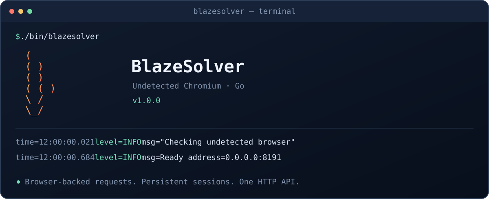

# BlazeSolver

**Real Chromium. A small HTTP API. Written in Go.**

[](https://github.com/cdxy1/BlazeSolver/actions/workflows/ci.yml)
[](https://github.com/cdxy1/BlazeSolver/releases)
[](go.mod)
[](LICENSE)
[](https://github.com/cdxy1/BlazeSolver/pkgs/container/blazesolver)



BlazeSolver opens pages in a real Chromium browser and returns their HTML,
cookies, user agent, and optional screenshot as JSON. It handles JavaScript-driven
pages and browser challenges through a patched ChromeDriver and a native Go
service.

Use it when a plain HTTP request is not enough, or when multiple requests need to
share a browser session. Challenge results depend on the target site and runtime
environment; no browser configuration guarantees access to every website.

[Quick start](#quick-start) · [HTTP API](#http-api) · [Configuration](#configuration) · [Development](#development) · [Releases](#releases)

## Features

- **Browser-backed GET and POST** with JavaScript execution and rendered HTML.
- **Persistent sessions** with cookies, explicit cleanup, and configurable TTL.
- **Fresh profiles** for requests that do not specify a session.
- **Proxy configuration** per request or when creating a session.
- **Optional screenshots** and resource blocking for images, stylesheets, and fonts.
- **Request logs and Prometheus metrics** for runtime visibility.
- **A small Go codebase:** one package, six runtime files, no external Go dependencies.
- **Multistage Docker builds** and images for AMD64, ARM64, ARMv7, and 386.

## Quick start

### Docker

The container includes the executable, Chromium, ChromeDriver, and Xvfb. No Go
installation is required on the host.

```sh
docker run -d \
  --name blazesolver \
  --restart unless-stopped \
  -p 127.0.0.1:8191:8191 \
  --tmpfs /tmp:size=512M,mode=1777 \
  ghcr.io/cdxy1/blazesolver:1.0.0
```

Check readiness:

```sh
curl --fail http://127.0.0.1:8191/health
# {"status":"ok"}
```

To build from this repository instead:

```sh
docker compose up --build -d
```

The runtime keeps executable drivers under `/config` and temporary browser
profiles under `/tmp`. The latter can use a noexec tmpfs without preventing the
driver from starting. Chromium determines most of the memory usage; size request
concurrency to fit the available RAM.

### From source

Install Go 1.24+ and Chrome or Chromium. Linux also needs Xvfb for the default
headless configuration.

```sh
git clone https://github.com/cdxy1/BlazeSolver.git
cd BlazeSolver
go build -trimpath -o bin/blazesolver .
./bin/blazesolver
```

A matching ChromeDriver is downloaded and patched on first startup if a local
one is not available. Set `CHROME_PATH` or `DRIVER_PATH` to select existing
executables. Use `PORT=18193 ./bin/blazesolver` to choose another port.

## HTTP API

Send JSON commands to `POST /v1`:

```sh
curl --fail-with-body http://127.0.0.1:8191/v1 \
  -H 'Content-Type: application/json' \
  -d '{
    "cmd": "request.get",
    "url": "https://example.com/",
    "maxTimeout": 60000
  }'
```

| Command | Purpose |
| --- | --- |
| `request.get` | Navigate to a page and return the browser result |
| `request.post` | Submit form data and return the resulting page |
| `sessions.create` | Start a persistent browser session |
| `sessions.list` | List active sessions |
| `sessions.destroy` | Close a session and release its resources |

`GET /` returns service information. `GET /health` returns readiness without
verbose request logs. Request failures return HTTP 500 with a JSON error response.

### Reuse a session

Explicit sessions avoid starting a browser for every request and preserve the
cookies obtained during navigation.

```sh
# Create a browser session.
curl --fail-with-body http://127.0.0.1:8191/v1 \
  -H 'Content-Type: application/json' \
  -d '{"cmd":"sessions.create","session":"example"}'

# Use it for one or more requests.
curl --fail-with-body http://127.0.0.1:8191/v1 \
  -H 'Content-Type: application/json' \
  -d '{"cmd":"request.get","session":"example","url":"https://example.com/"}'

# Close it when finished.
curl --fail-with-body http://127.0.0.1:8191/v1 \
  -H 'Content-Type: application/json' \
  -d '{"cmd":"sessions.destroy","session":"example"}'
```

Requests for the same session execute sequentially. Independent sessions can run
concurrently. Requests without a session use fresh browser profiles.

See the [full API reference](docs/API.md) for cookies, POST encoding, session TTL,
proxy settings, screenshots, resource blocking, and Turnstile parameters.

## Configuration

Configuration uses environment variables. Request-specific options are passed in
the JSON body.

| Variable | Default | Purpose |
| --- | --- | --- |
| `HOST` | `0.0.0.0` | HTTP listening interface |
| `PORT` | `8191` | HTTP port |
| `HEADLESS` | `true` | Run Chromium without a visible window |
| `LOG_LEVEL` | `info` | `debug`, `info`, `warn`, or `error` |
| `LOG_FILE` | unset | Also write logs to a file |
| `LOG_HTML` | `false` | Include page HTML in debug logs |
| `NO_COLOR` | unset | Disable terminal banner colors when set |
| `PROXY_URL` | unset | Default proxy URL |
| `PROXY_USERNAME` / `PROXY_PASSWORD` | unset | Default proxy credentials |
| `DISABLE_MEDIA` | `false` | Block images, stylesheets, and fonts |
| `BROWSER_WAIT_TIMEOUT` | `1` | Seconds per browser-state wait attempt |
| `CHROME_PATH` | autodetect | Chrome or Chromium executable |
| `DRIVER_PATH` | autodetect | Existing ChromeDriver executable |
| `DRIVER_CACHE_DIR` | platform cache | Cache for patched drivers; `/config/drivers` in Docker |
| `PROMETHEUS_ENABLED` | `false` | Enable the metrics server |
| `PROMETHEUS_PORT` | `8192` | Metrics server port |

### Observability

Logs include timestamps, request identifiers, commands, session identifiers, and
elapsed time. Use `LOG_LEVEL=debug` for browser details. `NO_COLOR=1` keeps the
startup banner free of ANSI colors.

Enable `PROMETHEUS_ENABLED=true` and expose port 8192 to scrape `/metrics`.
Application metrics include `blazesolver_request_total` and
`blazesolver_request_duration`, with domain and result labels where applicable.

## Development

```sh
go test -race ./...
go vet ./...
go test -tags=integration -run TestRealUndetectedBrowser -v -timeout 180s .
```

Unit tests cover the HTTP contract, validation, session lifecycle, concurrency,
encoding, driver patching, and protocol handling. Integration tests launch actual
Chromium against local pages to exercise cookies, screenshots, POST, challenge
transitions, Turnstile interactions, isolation, timeouts, and TTL.

The runtime, tests, and release tooling do not require Python. CI never sends
requests to live real-estate websites.

### Code map

| File | Responsibility |
| --- | --- |
| `main.go` | Startup banner, browser check, HTTP servers, shutdown |
| `config.go` | Environment configuration and input conversion |
| `server.go` | Routes, validation, and session lifecycle |
| `browser.go` | Driver patching, browser processes, WebDriver transport |
| `solve.go` | Navigation, cookies, challenge handling, results |
| `metrics.go` | Prometheus counters and histogram |

The Dockerfile separates Go compilation, browser package preparation, and the
final Debian runtime. The final image contains the compiled service and browser
dependencies, with neither the Go compiler nor Python installed.

## Releases

CI checks formatting, race tests, vet, cross-compilation, real Chromium on native
AMD64/ARM64 runners, and startup with a noexec tmpfs. Pull requests run checks
without publishing.

After checks pass:

| Trigger | Published artifacts |
| --- | --- |
| Push to the default branch | GHCR `latest` and `sha-<commit>` images |
| Version tag, such as `v1.0.0` | GHCR `1.0.0`, `v1.0.0`, `1.0`, and SHA tags; Linux/Windows archives |
| Stable version tag | Also updates the GHCR `latest` tag |

Publishing uses the repository's built-in `GITHUB_TOKEN`; no personal access
token is required. For anonymous image pulls, the GHCR package must be public.

Release archives include the executable and bundled Chrome. Update `package.json`
before tagging. On Linux, archives can also be built manually with curl, jq,
unzip, zip, and tar installed:

```sh
bash tools/build-release.sh linux
bash tools/build-release.sh windows
```

## License

[MIT](LICENSE) · Copyright 2026 cdxy1.
